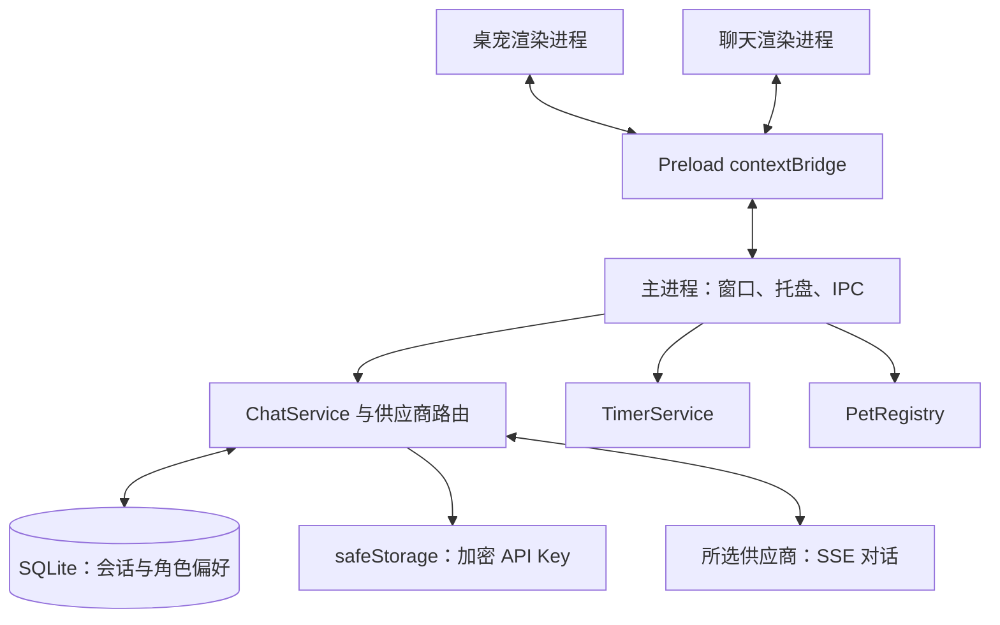

# Desktop-pet · 二次元桌宠

一款面向 macOS 的二次元桌面陪伴应用，支持 AI 角色对话、休息提醒与番茄钟。

[](https://github.com/zhenkun26/Desktop-pet/actions/workflows/ci.yml)
[](LICENSE)
[](https://www.electronjs.org/)
[](#环境要求)

[English](README.md) | **简体中文**

<p align="center">
  
</p>

Desktop-pet 将可拖拽、始终置顶的角色带到桌面上。你可以与角色聊天、调整个性化设定，并用休息提醒和番茄钟平衡专注与休息。目前内置角色为**胡桃**，也支持通过源码注册其他角色。

> **美术资源声明**：胡桃立绘及角色形象等美术资源版权归 miHoYo（米哈游）所有。依照仓库现有声明，这些素材仅供个人学习与交流，禁止商用或二次分发。MIT 许可证适用于代码部分；如需商用，请替换为自有素材。

## 目录

- [功能特性](#功能特性)
- [快速开始](#快速开始)
- [配置说明](#配置说明)
- [开发指南](#开发指南)
- [新增角色](#新增角色)
- [相关文档](#相关文档)
- [参与贡献](#参与贡献)
- [帮助与常见问题](#帮助与常见问题)
- [致谢](#致谢)
- [许可证](#许可证)

## 功能特性

- **桌面陪伴**：透明窗口、拖拽与点击交互、分时段问候、对话气泡和思考动画。
- **AI 角色对话**：流式文本回复、会话历史和可自定义的角色偏好，使用 `marked` 与 DOMPurify 渲染 Markdown。
- **多供应商与多模型**：通过 OpenAI-compatible 适配器配置连接，共享或隔离凭据，并按会话选择模型；内置默认供应商为 DeepSeek。
- **三语回复**：支持中文（`zh-CN`）、英文（`en-US`）和日文（`ja-JP`），分别保存新会话默认语言与当前会话语言。
- **专注与休息**：休息提醒按桌宠可见期间的时长累计，默认每 45 分钟提醒一次；番茄钟默认为专注 25 分钟、休息 5 分钟。

界面目前以中文为主。语言设置控制 AI 回复语言，不会翻译界面。开箱即用的注册角色仅有胡桃。

## 快速开始

### 环境要求

- macOS，主要面向 Apple Silicon / arm64。
- Node.js **22.13 或更高版本**，包含内置的 `node:sqlite` 模块。
- npm，随 Node.js 提供。
- 使用 AI 对话时，需要所选供应商的 API Key。

### 从源码运行

```bash
git clone https://github.com/zhenkun26/Desktop-pet.git
cd Desktop-pet
npm ci
npm run dev
```

`npm ci` 按 `package-lock.json` 安装锁定版本的依赖。如需生成 macOS 磁盘映像，请参阅[开发指南](#开发指南)。

### 开始第一次对话

1. 右键点击桌宠，选择**和我聊天**。菜单栏图标也提供聊天入口与桌宠显示控制。
2. 打开**设置**。使用默认 DeepSeek 连接时，在 **API 设置**中填写 API Key，保存后点击**测试连接**。
3. 返回**对话**，在对话框下方选择可用模型并发送消息。`Enter` 发送，`Shift+Enter` 换行。
4. 打开**角色**调整个性化设定，或打开**时钟**配置休息提醒与番茄钟。

## 配置说明

### 供应商与模型

在**设置 → 多供应商模型**中依次完成：

1. 保存供应商连接，填写名称、Base URL 和凭据 ID。端点必须使用 HTTPS；只有显式允许后，本机回环地址才能使用 HTTP。
2. 在该连接的卡片中保存 API Key。
3. 使用供应商提供的模型 ID 和显示名称添加模型，再选择新会话默认模型。
4. 添加模型后，在连接卡片中测试连接。使用自定义供应商聊天前，确认允许将消息发送到该供应商。

同一连接下的模型共享其凭据。不同连接可以复用凭据 ID 来共享 API Key，也可以使用不同的连接与凭据 ID 来隔离密钥。对话框只列出已启用、连接和凭据均可用的模型。

切换模型只影响后续消息。正在进行的请求继续使用开始时保存的供应商、模型和凭据选择。实际兼容性取决于供应商是否支持适配器的请求格式，详见[路由规范](openspec/specs/multi-provider-model-routing/spec.md)。

### 对话语言

在**设置 → 对话语言**中选择新会话默认语言，或修改当前会话的回复语言。

每个会话独立保存语言。修改只影响之后发送的消息；正在生成的回复继续使用原语言，已有消息不会被翻译或改写。语言要求通过提示词传递，不调用独立翻译服务。

### 本地数据与凭据

会话与角色偏好保存在本地 SQLite 数据库中，应用和供应商设置保存在 Electron `userData` 目录下的 JSON 文件中。打包后的 macOS 应用通常使用 `~/Library/Application Support/二次元桌宠/`。

已保存的 API Key 由主进程通过 Electron `safeStorage` 加密和解密。凭据状态接口返回标识、掩码和可用状态，不返回已保存密钥的明文。系统加密不可用时，应用会拒绝保存密钥。

旧 Electron 版本的 `deepseek-api-key.bin` 凭据和缺少模型字段的会话会沿用默认 DeepSeek 配置，不改写已有消息。更早的 Tauri 凭据使用不同格式，详见下方升级说明。

AI 请求会将提示词和会话上下文发送到所选供应商。本地保存历史记录不代表供应商对话可离线运行。安全问题报告方式见[安全政策](docs/SECURITY.md)。

## 开发指南

### 常用命令

| 命令 | 用途 |
| --- | --- |
| `npm run dev` | 启动 Electron 开发模式，支持开发重载 |
| `npx tsc --noEmit` | 检查 TypeScript 类型 |
| `npm test` | 运行 Vitest 单元测试 |
| `npm run test:coverage` | 生成测试覆盖率报告 |
| `npm run build` | 将主进程、preload 和渲染层构建到 `out/` |
| `npm run preview` | 预览已构建的应用 |
| `npm run build:mac` | 构建并打包 macOS DMG，输出到 `release/` |
| `npm run build:unpack` | 构建未封装为安装包的应用，输出到 `release/` |

桌面技术栈为 Electron 39、TypeScript 严格模式、electron-vite 2 和 Vite 5。持久化使用内置 `node:sqlite`，无需额外的原生 SQLite 依赖。锁文件中的 TypeScript 版本为 **5.9.3**，声明范围仍为 `^5.7.2`。

macOS 打包工作流禁用了签名身份自动发现，未配置签名与公证发布。当前 CI 工作流不覆盖 Windows 和 Linux 打包。

如网络环境需要 Electron 下载镜像，请在本地配置，不要将个人镜像设置提交到仓库。

### 架构概览



主进程负责对话生成、供应商路由、计时器和凭据，渲染进程通过类型化 preload 桥通信。assistant 消息在生成期间持续落库，发送消息的 IPC 调用在生成终结时返回；流式事件提供增量界面更新。历史消息与正在生成的回复使用独立 DOM 容器。

<details>
<summary>项目结构</summary>

```text
src/
  main/          Electron 生命周期、窗口、托盘、IPC 与服务
    services/
      chat/      对话状态、供应商路由、SQLite 与凭据
      pet/       角色注册表
      timer/     休息提醒与番茄钟状态
  preload/       类型化 contextBridge API
  renderer/      桌宠与聊天视图、样式和立绘
  shared/        共享类型与接口契约
test/mocks/      单元测试使用的 Electron 模拟实现
resources/       应用与菜单栏图标
docs/            指南、架构决策与历史记录
openspec/        行为规范与变更工件
scripts/         构建产物冒烟检查
.github/         CI、打包工作流与协作模板
```

</details>

根目录 `Dockerfile` 用于容器内构建和产物冒烟检查。[Kubernetes 清单](docs/reference/k8s/README.md) 是未来服务端组件的参考模板；桌面应用在本机运行。

## 新增角色

角色支持在源码中定义。注册新的桌宠时：

1. 将有权使用的立绘放入 `src/renderer/assets/<petId>.png`。
2. 在[共享类型](src/shared/types.ts)的 `PetId`、`PET_IDS` 和 `PET_LABELS` 中增加角色 ID。
3. 在 [personas.ts](src/main/services/chat/personas.ts) 的 `BUILTIN_PERSONAS` 中添加条目，包括核心身份、说话风格与默认偏好字段。注册表会读取这些人设定义。
4. 在 [pet-registry.ts](src/main/services/pet/pet-registry.ts) 中登记 `PetDescriptor`，填写 ID、显示名称、素材文件名、身份、说话风格和问候语。

现有桥接接口提供 `listPets()`、`getPet(petId)` 和 `openChat({ petId, view })`。会话与人设按角色 ID 隔离，[pet-assets.ts](src/renderer/pet-assets.ts) 为构建解析素材 URL。桌宠依据 `config.petId` 展示立绘和问候语。扩展注册表后，请运行类型检查、测试与构建。

## 相关文档

| 文档 | 内容 |
| --- | --- |
| [更新日志](CHANGELOG.md) | 版本历史与尚未发布的变更 |
| [贡献指南](docs/CONTRIBUTING.md) | 开发流程与 PR 要求 |
| [安全政策](docs/SECURITY.md) | 安全报告方式与约定 |
| [架构决策](docs/DECISIONS.md) | 设计选择、证据与验证边界 |
| [问题复盘](docs/PROBLEM_REVIEWS.md) | 精选问题调查与经验 |
| [回复语言规范](openspec/specs/conversation-response-language/spec.md) | 会话语言行为 |
| [供应商路由规范](openspec/specs/multi-provider-model-routing/spec.md) | 供应商、模型与凭据契约 |
| [历史审查报告](docs/history/ADVERSARIAL_REVIEW_REPORT.md) | 早期审查发现与测试结果 |
| [历史执行计划](docs/history/EXECUTION_PLAN.md) | 早期实现计划 |

历史报告描述其记录时的版本，其中的测试数量与结果不能证明当前提交的状态；请查看对应提交的 CI 运行结果。尚未完成的 GUI 和迁移手动检查记录在 OpenSpec 任务与工程文档中。

## 参与贡献

修改前请阅读 [CONTRIBUTING.md](docs/CONTRIBUTING.md) 与 [AGENTS.md](AGENTS.md)。功能、修复与行为变更从 [OpenSpec change](openspec/changes/) 开始，依次完成提案、规范、设计和任务。纯文档变更可以声明 `skip_specs: true`。

使用 Conventional Commits 提交，并向 `main` 发起 PR。修改两种语言共有的信息时，请同步中英文 README。CI 会检查类型、构建应用、运行单元测试，并使用 Gitleaks 扫描敏感信息。

## 帮助与常见问题

- **提问、报告缺陷或建议功能**：请使用 [GitHub Issues](https://github.com/zhenkun26/Desktop-pet/issues)，提供 macOS 版本、应用版本、复现步骤和脱敏后的错误信息。
- **对话没有可选模型**：检查供应商与模型是否启用、凭据是否已保存、连接测试是否成功；使用自定义供应商时，还需确认消息发送路径。
- **桌宠隐藏或移到屏幕外**：通过菜单栏图标重新显示；显示桌宠时会将完全移出屏幕的窗口移回可见区域。
- **从旧版升级**：请查看[更新日志](CHANGELOG.md)中的迁移说明与限制。旧 Tauri 版本的凭据和自定义人设需要重新配置；迁移的手动验收状态另有记录。
- **安全问题**：遵循 [SECURITY.md](docs/SECURITY.md)。请勿在 Issue、PR 或对外分享的日志中包含真实 API Key。

## 致谢

感谢 [kirineko/desktop-pet](https://github.com/kirineko/desktop-pet)，本项目的窗口、拖拽、气泡交互、流式聊天事件与工程结构参考了其架构和实现。

贡献者与分工见 [CONTRIBUTORS.md](CONTRIBUTORS.md)。本项目使用 AI 编程工具辅助开发，最终评审与发布责任由项目负责人承担。

## 许可证

代码采用 [MIT 许可证](LICENSE)。胡桃立绘与角色形象等美术资源遵循上方独立声明，不属于代码许可证的授权范围。
