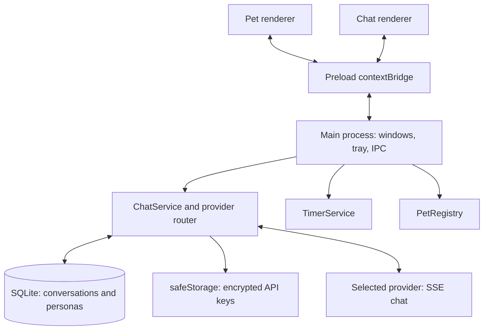

# Desktop-pet

An anime desktop companion for macOS, with AI character chat, rest reminders, and a Pomodoro timer.

[](https://github.com/zhenkun26/Desktop-pet/actions/workflows/ci.yml)
[](LICENSE)
[](https://www.electronjs.org/)
[](#requirements)

**English** | [简体中文](README-zh.md)

<p align="center">
  
</p>

Desktop-pet puts a draggable, always-on-top character on your desktop. Chat in character, personalize your companion, and use gentle reminders to balance focus and breaks. The app currently includes **Hutao** and a registry for adding other characters in source.

> **Artwork notice:** Hutao artwork and character assets belong to miHoYo. Under this repository's existing notice, they are for personal learning and exchange only; commercial use and redistribution are prohibited. The MIT license covers the code. Replace these assets with your own for commercial use.

## Contents

- [Features](#features)
- [Quick start](#quick-start)
- [Configuration](#configuration)
- [Development](#development)
- [Adding a character](#adding-a-character)
- [Documentation](#documentation)
- [Contributing](#contributing)
- [Help and troubleshooting](#help-and-troubleshooting)
- [Acknowledgments](#acknowledgments)
- [License](#license)

## Features

- **Desktop companion:** transparent window, drag and click interactions, time-based greetings, speech bubbles, and a thinking animation.
- **AI character chat:** streamed text replies, saved conversations, and customizable persona preferences, with Markdown rendered through `marked` and DOMPurify.
- **Multiple providers and models:** configure connections through an OpenAI-compatible adapter, share or separate credentials, and select a model for each conversation. DeepSeek is the built-in default.
- **Three response languages:** Chinese (`zh-CN`), English (`en-US`), and Japanese (`ja-JP`), with separate defaults for new conversations and settings for the current conversation.
- **Focus and breaks:** rest reminders count time while the pet is visible; the default reminder interval is 45 minutes, and the Pomodoro timer defaults to 25 minutes of work and 5 minutes of rest.

The interface is primarily Chinese. Response-language settings control AI replies, rather than translating the interface. Only Hutao is registered out of the box.

## Quick start

### Requirements

- macOS, with Apple Silicon / arm64 as the primary target.
- Node.js **22.13 or later**, including the built-in `node:sqlite` module.
- npm, included with Node.js.
- An API key for your selected provider to use AI chat.

### Run from source

```bash
git clone https://github.com/zhenkun26/Desktop-pet.git
cd Desktop-pet
npm ci
npm run dev
```

`npm ci` installs the versions recorded in `package-lock.json`. To create a macOS disk image, see [Development](#development).

### Start your first conversation

1. Right-click the pet and choose **Chat with me** (`和我聊天`). The menu-bar icon also offers chat and pet visibility controls.
2. Open **Settings** (`设置`). For the default DeepSeek connection, enter your key under **API settings** (`API 设置`), save it, and use **Test connection** (`测试连接`).
3. Return to **Chat** (`对话`), choose an available model below the conversation, and send a message. Use `Enter` to send and `Shift+Enter` for a new line.
4. Open **Character** (`角色`) to personalize the persona, or **Clock** (`时钟`) to configure reminders and the Pomodoro timer.

## Configuration

### Providers and models

Use **Settings → Multi-provider models** (`设置 → 多供应商模型`) to:

1. Save a provider connection with a name, Base URL, and credential ID. Endpoints must use HTTPS; HTTP is allowed only for loopback hosts when explicitly enabled.
2. Save the API key in that connection's card.
3. Add a model with the provider's model ID and a display name, then choose the default model for new conversations.
4. Test the connection from its card after adding the model. Confirm that messages may be sent to a custom provider before using it for chat.

Models on one connection share its credential. Reuse a credential ID across connections to share a key, or create separate connections and credential IDs for independent keys. The conversation selector lists enabled models whose connections and credentials are available.

Switching models affects subsequent messages. An active request keeps the provider, model, and credential selection captured when it started. Compatibility depends on the provider's support for the adapter's request format; see the [routing specification](openspec/specs/multi-provider-model-routing/spec.md).

### Conversation language

In **Settings → Conversation language** (`设置 → 对话语言`), select the default for new conversations or the response language for the current conversation.

Each conversation stores its own language. A change applies to messages sent afterward; an active response keeps its original language, and existing messages are not translated or rewritten. The language instruction is part of the prompt and uses no separate translation service.

### Local data and credentials

Conversations and persona preferences are stored locally in SQLite. App and provider settings are stored in local JSON files under Electron's `userData` directory. In the packaged macOS app, this is normally `~/Library/Application Support/二次元桌宠/`.

Saved API keys are encrypted and decrypted in the main process using Electron `safeStorage`. Credential status responses expose identifiers, masks, and availability, rather than stored plaintext keys. The application refuses to save keys when system encryption is unavailable.

The legacy Electron `deepseek-api-key.bin` credential and conversations without model fields resolve to the default DeepSeek configuration, without rewriting existing messages. Older Tauri credentials use a different format; see the upgrade notes below.

AI requests send the prompt and conversation context to the selected provider. Local history storage does not make provider-based chat offline. See the [security policy](docs/SECURITY.md) for reporting security issues.

## Development

### Commands

| Command | Purpose |
| --- | --- |
| `npm run dev` | Launch Electron with development reload support |
| `npx tsc --noEmit` | Check TypeScript types |
| `npm test` | Run the Vitest unit tests |
| `npm run test:coverage` | Generate test coverage reports |
| `npm run build` | Build main, preload, and renderer bundles into `out/` |
| `npm run preview` | Preview the built application |
| `npm run build:mac` | Build and package a macOS DMG in `release/` |
| `npm run build:unpack` | Build an unpacked application in `release/` |

The desktop stack is Electron 39, TypeScript in strict mode, electron-vite 2, and Vite 5. Persistence uses built-in `node:sqlite`, without a separate native SQLite dependency. The lockfile records TypeScript **5.9.3**; the declared range remains `^5.7.2`.

The macOS packaging workflow disables automatic signing-identity discovery. Signed and notarized distribution is not configured by that workflow. Windows and Linux packaging are not covered by the current CI workflow.

If your network requires an Electron download mirror, configure it locally and keep personal mirror settings out of commits.

### Architecture



The main process owns chat generation, provider routing, timers, and credentials. Renderers communicate through the typed preload bridge. Assistant messages are persisted during generation, and the send-message IPC call resolves at termination; stream events provide incremental UI updates. Historical messages and the active stream use separate DOM containers.

<details>
<summary>Project layout</summary>

```text
src/
  main/          Electron lifecycle, windows, tray, IPC, and services
    services/
      chat/      Chat state, provider routing, SQLite, and credentials
      pet/       Character registry
      timer/     Rest reminders and Pomodoro state
  preload/       Typed contextBridge API
  renderer/      Pet and chat views, styles, and artwork
  shared/        Shared types and contracts
test/mocks/      Electron mocks for unit tests
resources/       App and menu-bar icons
docs/            Guides, architecture decisions, and historical records
openspec/        Behavior specifications and change artifacts
scripts/         Build-artifact smoke checks
.github/         CI, packaging workflow, and collaboration templates
```

</details>

The root `Dockerfile` supports container builds and artifact smoke checks. [Kubernetes manifests](docs/reference/k8s/README.md) are reference templates for a future server component; the desktop application runs locally.

## Adding a character

Character support is defined in source. To register another pet:

1. Add artwork that you have permission to use at `src/renderer/assets/<petId>.png`.
2. Add the ID to `PetId`, `PET_IDS`, and `PET_LABELS` in [shared types](src/shared/types.ts).
3. Add an entry to `BUILTIN_PERSONAS` in [personas.ts](src/main/services/chat/personas.ts), including identity, speech style, and default preference fields. The registry reads these persona definitions.
4. Register a `PetDescriptor` in [pet-registry.ts](src/main/services/pet/pet-registry.ts) with the ID, display name, asset filename, identity, speech style, and greetings.

The existing bridge provides `listPets()`, `getPet(petId)`, and `openChat({ petId, view })`. Conversations and personas are scoped by pet ID, and [pet-assets.ts](src/renderer/pet-assets.ts) resolves artwork URLs for the build. The desktop pet uses `config.petId` for its artwork and greetings. Run type checks, tests, and a build after extending the registry.

## Documentation

| Document | Contents |
| --- | --- |
| [Changelog](CHANGELOG.md) | Release history and unreleased changes |
| [Contributing guide](docs/CONTRIBUTING.md) | Development workflow and PR requirements |
| [Security policy](docs/SECURITY.md) | Security reporting and conventions |
| [Architecture decisions](docs/DECISIONS.md) | Design choices, evidence, and verification limits |
| [Problem reviews](docs/PROBLEM_REVIEWS.md) | Selected investigations and lessons learned |
| [Response-language specification](openspec/specs/conversation-response-language/spec.md) | Conversation language behavior |
| [Provider-routing specification](openspec/specs/multi-provider-model-routing/spec.md) | Provider, model, and credential contracts |
| [Historical review report](docs/history/ADVERSARIAL_REVIEW_REPORT.md) | Earlier review findings and test results |
| [Historical execution plan](docs/history/EXECUTION_PLAN.md) | Earlier implementation planning |

Historical reports describe their recorded revision. Their test counts and results do not establish the status of the current commit; use the linked CI run for commit-specific checks. Outstanding manual GUI and migration checks are recorded in the OpenSpec tasks and engineering documents.

## Contributing

Read [CONTRIBUTING.md](docs/CONTRIBUTING.md) and [AGENTS.md](AGENTS.md) before making changes. Feature, fix, and behavior changes start with an [OpenSpec change](openspec/changes/), followed by proposal, specifications, design, and tasks. Documentation-only changes can declare `skip_specs: true`.

Use Conventional Commits and open a pull request against `main`. Keep the English and Chinese READMEs consistent when changing shared information. CI checks types, builds the app, runs unit tests, and scans for secrets with Gitleaks.

## Help and troubleshooting

- **Questions, bugs, or feature requests:** use [GitHub Issues](https://github.com/zhenkun26/Desktop-pet/issues). Include your macOS version, app version, reproduction steps, and redacted error details.
- **No selectable chat model:** check that the provider and model are enabled, a credential is saved, and the connection test succeeds. Confirm the message route for a custom provider.
- **Pet hidden or off-screen:** use the menu-bar icon to show it again; showing the pet recovers a fully off-screen window.
- **Upgrading from an older version:** see the migration notes and limitations in the [changelog](CHANGELOG.md). Legacy Tauri credentials and customized personas need to be configured again; manual migration acceptance remains documented separately.
- **Security issues:** follow [SECURITY.md](docs/SECURITY.md). Never include real API keys in issues, pull requests, or logs shared with others.

## Acknowledgments

Thanks to [kirineko/desktop-pet](https://github.com/kirineko/desktop-pet) for the architecture and implementation references for window, drag, and speech-bubble interactions, streaming chat events, and project structure.

See [CONTRIBUTORS.md](CONTRIBUTORS.md) for contributors and roles. The project was developed with AI coding assistance; the project owner remains responsible for review and releases.

## License

The code is licensed under the [MIT License](LICENSE). Hutao artwork and character assets are subject to the separate artwork notice above and are not covered by the code license.
